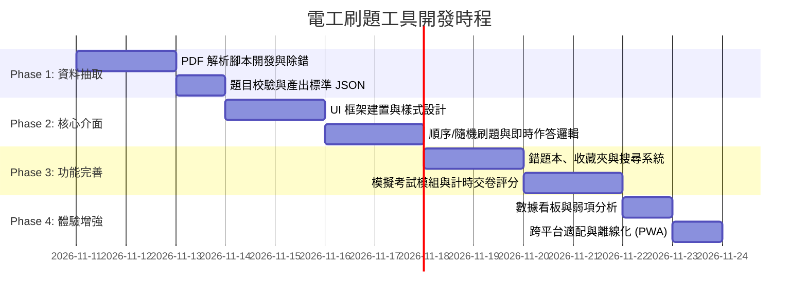

# 電工技能測試刷題工具 - 專案開發計劃書

> **專案版本**：v1.0  
> **建立日期**：2026-11-10  
> **目標題庫**：澳門勞工事務局技能測試題庫（中級維修電工、初級維修電工、初級電氣設備安裝工）

---

## 1. 專案背景與目標

本專案旨在為準備電工職業技能測試的從業人員及考生，打造一套**直覺、流暢、功能完備且支援跨平台（電腦與手機）**的本機/離線刷題工具。

### 現有題庫資產
目前工作目錄中已有三份官方題庫 PDF：
1. **《中級維修電工 技能測試題庫》**（133 頁，約 920+ 題，含是非題與選擇題，共 6 大章節）
2. **《初級維修電工 技能測試題庫》**（148 頁，是非題與選擇題，共 6 大章節）
3. **《初級電氣設備安裝工 技能測試題庫》**（80 頁，是非題與選擇題）

### 核心目標
- **自動化題庫抽取**：利用 Python 腳本將 PDF 題庫精準解析轉換為結構化 JSON 格式，保證題目、選項、答案、分類章節無錯漏。
- **全功能刷題體驗**：支援順序練習、隨機抽題、模擬測驗、錯題複習、題目收藏與關鍵字搜尋。
- **數據持久化**：使用瀏覽器本地儲存（LocalStorage / IndexedDB），自動記錄作答進度、正確率統計與錯題本，無須後端資料庫亦不丟失進度。
- **輕量與高可用**：支援離線運行、響應式設計（適配手機與桌面端），甚至可一鍵打包為靜態網頁或 PWA。

---

## 2. 系統架構與技術選型

```mermaid
flowchart TD
    subgraph DataPipeline [資料處理層 (Python)]
        PDF[PDF 題庫檔案] --> Parser[PyMuPDF 解析器]
        Parser --> Validator[題目資料校驗工具]
        Validator --> JSON[標準題庫 JSON 資料庫]
    end

    subgraph AppLayer [刷題應用層 (前端 Web)]
        JSON --> AppCore[核心業務邏輯]
        AppCore --> Views[UI 介面層]
        Views --> Practice[練習模式 / 模擬考 / 錯題本]
        AppCore <--> Storage[(瀏覽器 LocalStorage / IndexedDB)]
    end
```

### 2.1 資料處理層（ETL）
- **語言**：Python 3.12
- **函式庫**：`PyMuPDF (fitz)`、`re`、`json`
- **職責**：
  - 抽取表格與文字版面結構。
  - 識別題型（是非題 / 四選一選擇題）。
  - 清理分頁符號、頁首頁尾、換行破詞。
  - 產出標準化 JSON 資料結構。

### 2.2 前端刷題應用層
- **架構方案**：現代響應式單頁應用（SPA / 靜態 Web App）
  - **優勢**：無需安裝複雜環境，開箱即用；可直接在瀏覽器本機開啟，亦可透過區網或靜態網站託管（如 GitHub Pages）在手機上隨時刷題。
- **技術棧建議**：
  - **核心框架**：HTML5 + Vue 3 / 原生現代 JavaScript (ES Modules)
  - **樣式庫**：Tailwind CSS（簡潔專業的學習介面、夜間模式支援）
  - **本地儲存**：LocalStorage（儲存設置、作答歷史、錯題、收藏）
  - **圖標與字型**：Lucide Icons（提供流暢的視覺圖標）

---

## 3. 核心功能規格

### 3.1 題庫切換與分類篩選
- **科目切換**：在中級維修電工、初級維修電工、初級設備安裝工之間快速切換。
- **題型篩選**：是非題、選擇題、全部混合。
- **章節篩選**：
  1. 工作規範與電工安全
  2. 電工基礎
  3. 電工儀錶測量
  4. 低壓電器與照明電路
  5. 電機與電氣控制
  6. 電子技術基礎

### 3.2 刷題模組
| 模式 | 特性說明 |
| :--- | :--- |
| **順序練習 (Learn)** | 按照題庫編號逐題推進，作答後立即揭曉答案與正誤，記憶學習進度，支援跳題。 |
| **隨機刷題 (Shuffle)** | 打亂全題庫或特定章節題目順序，避免題目死記位置，強化概念。 |
| **模擬考試 (Exam)** | 依官方考試比例隨機抽題（如是非 50 題 + 選擇 50 題），倒數計時，交卷後統一批改評分並出具成績單。 |
| **錯題本 (Weakness)** | 自動收集所有練習與考試中答錯的題目；支援「消滅錯題」模式（答對一定次數後自動移出）。 |
| **題目收藏 (Favorites)** | 學生可手動收藏重點題目、易混淆陷阱題，便於考前衝刺複習。 |
| **題目搜尋 (Search)** | 支援全文搜尋題目關鍵字，快速查閱某項法規或電工術語相關題目。 |

### 3.3 人機互動細節
- **鍵盤快捷鍵**（電腦端）：
  - 是非題：`T` / `O` / `1` 代表正確，`F` / `X` / `2` 代表錯誤。
  - 選擇題：數字鍵 `1~4` 或字母鍵 `A~D` 快速選擇。
  - 導航鍵：`Enter` / `Space` / `→` 下一題，`←` 上一題。
- **手機端手勢**：左右滑動切換上一題/下一題，按鈕大尺寸防誤觸。
- **作答反饋**：
  - 答對：輕量綠色視覺提示 + 選擇題高亮正確選項。
  - 答錯：紅色警示 + 標明你的選擇與正確解答。
  - 解析與備註：可由使用者為特定難題自行添加心得註記。
- **深色模式（Dark Mode）**：夜間刷題護眼支援。

### 3.4 統計與進度看板
- **總進度條**：已刷題數 / 總題數、總體正確率。
- **章節掌握度**：各章節雷達圖或進度長條圖，一眼看出哪一章（如電工基礎 vs 電機控制）為弱項。
- **資料備份與還原**：支援將個人作答記錄、錯題本匯出為 JSON，便於換手機或電腦時無縫同步。

---

## 4. 題庫資料結構規格 (JSON Schema)

題庫轉換後的 JSON 標準範例：

```json
{
  "subject_id": "mid_maintenance_electrician",
  "subject_name": "中級維修電工",
  "version": "2026",
  "total_questions": 920,
  "categories": [
    "工作規範與電工安全",
    "電工基礎",
    "電工儀錶測量",
    "低壓電器與照明電路",
    "電機與電氣控制",
    "電子技術基礎"
  ],
  "questions": [
    {
      "id": "mid_tf_001",
      "type": "tf",
      "category": "工作規範與電工安全",
      "question": "斷電拉閘操作應先拉開負荷開關 (油開關)，後拉下隔離開關。",
      "options": [],
      "answer": "O",
      "explanation": ""
    },
    {
      "id": "mid_mc_001",
      "type": "mc",
      "category": "工作規範與電工安全",
      "question": "用圓鋼敷設在室外的地面上作接地線，其最少直徑應為多少毫米(mm)？",
      "options": [
        {"key": "A", "text": "5mm"},
        {"key": "B", "text": "6mm"},
        {"key": "C", "text": "8mm"},
        {"key": "D", "text": "12mm"}
      ],
      "answer": "B",
      "explanation": ""
    }
  ]
}
```

---

## 5. 實施階段與時程規劃 (Roadmap)



### 里程碑細節

- **階段一：資料解析與題庫建庫 (Phase 1)**
  1. 編寫 Python 解析腳本 `parse_pdf_to_json.py`。
  2. 針對「中級維修電工」、「初級維修電工」、「初級設備安裝工」進行全面解析。
  3. 資料校驗（檢查有無缺漏選項、未匹配答案、亂碼等問題），產出資料集。

- **階段二：前端核心原型開發 (Phase 2)**
  1. 搭建乾淨現代的前端單頁面介面（支援響應式佈局）。
  2. 載入題庫 JSON，實作題庫/科目/章節切換器。
  3. 完成「順序練習」與「隨機刷題」模式，具備按鍵/點擊反饋及正誤判定。

- **階段三：深度功能與儲存機制 (Phase 3)**
  1. 實作 LocalStorage 資料持久化（記錄答題進度、答題歷史）。
  2. 實作「錯題本」自動歸檔與錯題消滅機制。
  3. 實作「我的收藏」與關鍵字全文檢索功能。
  4. 實作「模擬考試模式」：隨機抽題、時間倒數、答題卡快速定位、成績報告單。

- **階段四：進度統計與體驗優化 (Phase 4)**
  1. 設計個人學習儀表板（總正確率、各章節答題進度條、常錯題排行）。
  2. 快捷鍵增強、深色模式切換。
  3. 資料備份/還原功能（匯出/匯入作答進度 JSON）。

- **階段五：發布與交付 (Phase 5)**
  1. 整合為本機免安裝隨點即開的工具包（提供一鍵啟動腳本或直接雙擊瀏覽器開啟）。
  2. 撰寫使用說明手冊與操作指南。

---

## 7. 當前實施成果與系統狀態 (v2.0)

- [x] **題庫全數抽取完成 (共 1,858 題)**：
  - 中級維修電工 (920 題，含 64 張高清電路圖與元件圖)
  - 初級維修電工 (610 題)
  - 初級電氣設備安裝工 (328 題)
- [x] **官方純淨模式**：
  - 已下架所有非官方自訂解析與編輯器，作答後僅顯示官方標準答案（O/X、A/B/C/D）、出處章節與手冊頁碼。
- [x] **核心功能全數實現**：
  - 順序練習、隨機刷題、模擬考試（計時評分）、錯題重練、題目收藏、關鍵字全文搜尋。
  - 指定題號即時跳轉輸入框。
  - 答題卡進度總覽（一覽已完成／未完成／做錯題號）。
  - 「只刷未做題」一鍵切換。
- [x] **雲端與跨裝置同步 (方案 C)**：
  - 整合 Firebase Auth（Email 登入）與 Cloud Firestore 背景防抖雙向同步。
  - 支援智慧合併（Smart Merge），手機與電腦刷題進度永不覆蓋遺失。
  - 支援離線本機備份匯出與匯入（JSON 全科目 v2.0）。
- [x] **雲端線上發布**：
  - GitHub Pages 部署網址：`https://594siscon.github.io/lectrician-quiz/`
  - GitHub 倉庫：`https://github.com/594siscon/lectrician-quiz.git`


